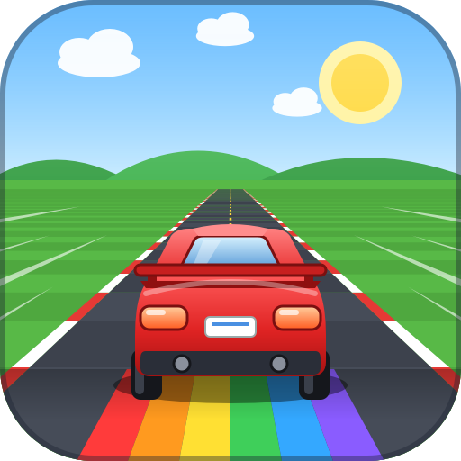

<p align="center">
  
</p>

<h1 align="center">Road Racer</h1>

<p align="center">
  A colourful top-down arcade racer made for a 3-year-old: hold <b>one button</b> and the car drives itself.<br>
  Built with Godot 4.7 (GDScript). Two-player side-by-side split screen, keyboard and gamepad.
</p>

> New here? Read [GAME_FEATURES.md](GAME_FEATURES.md) for what the game does and how it plays.

## Play

Download the latest `RoadRacer-windows.zip` from the **Releases** page, unzip it and run `RoadRacer.exe`.
No installer is needed.

## Build it yourself

You need two things from [godotengine.org/download](https://godotengine.org/download):

1. **Godot 4.7.2 (Standard version, not .NET)** - the editor. On Windows it is a single portable `.exe`, there is nothing to install.
2. **The matching export templates (4.7.2)** - only needed to produce a `.exe`; not needed to just run the game from the editor.
   * In the editor: **Editor -> Manage Export Templates -> Download and Install**, or
   * Download `Godot_v4.7.2-stable_export_templates.tpz` from the Godot download page and use
     **Editor -> Manage Export Templates -> Install From File**.

The templates must be the same version as the editor (4.7.2), otherwise the export is refused.

### Run from the editor
1. Clone this repository.
2. Start Godot, click **Import**, choose `project.godot` in the cloned folder, then press **F5** (Play).
   The first open takes a moment while Godot imports the images and sounds.

Or from a terminal: `godot --path .`

### Export a Windows executable
* In the editor: **Project -> Export...**, choose the **Windows Desktop** preset, **Export Project**
  (the preset is already set up to write `build/RoadRacer.exe`, with the data embedded in the exe).
* Or from a terminal (run `godot --headless --path . --import` once first on a fresh clone):

  ```
  godot --headless --path . --export-release "Windows Desktop" build/RoadRacer.exe
  ```

The exe gets the game icon and name from the export preset; Godot does this itself, so you do not need rcedit or Wine.
The `build/` folder is git-ignored.

### Automatic builds (GitHub Actions)
`.github/workflows/build.yml` builds the Windows exe on every push to `master` and on pull requests (download it from the
run's **Artifacts**). Pushing a version tag such as `v1.0.0` also creates a GitHub Release with `RoadRacer-windows.zip` attached:

```
git tag v1.0.0
git push origin v1.0.0
```

The pipeline makes a **release build** without debug symbols, and checks that:
* it is built with a **small custom export template** (`.github/godot/custom.py`: 2D only, size-optimised, only the engine
  parts the game uses). The first run compiles it (about an hour); later runs reuse the cached copy. If the template build
  fails, the stock Godot release template is used instead (the job summary says which one was used);
* the exe has no debug sections or symbol table, and no script source (`.gd`) or notes are packed inside it
  (`.github/scripts/pck_list.py`);
* the exe starts and plays a short two-player race on Windows (`RoadRacer.exe --headless -- --smoke-test --expect-release`).

If the game starts using an engine feature the custom template left out (the smoke test then fails), enable its module in
`.github/godot/custom.py`.

## Menus

Home -> (Stage Select) -> **Who plays?** -> **Cars** -> race. Home also has **Options** and Full Screen.
**Stage Select** lists the 6 worlds with their 3 stages each as picture cards (a screenshot of the road, its weather, time
of day, lanes and length, a short description and your best score). The list scrolls with the focus. A stage opens when
the one before it has been cleared; a locked one can be looked at but not started.

| | Keyboard | Gamepad |
|---|---|---|
| Move in menus | arrow keys or W A S D | D-pad or left stick |
| Confirm / choose / continue | Enter (or Space) | A (Cross) |
| Back | Esc | B (Circle) |
| Full screen on / off (anywhere) | F11 or Alt+Enter | |

**Who plays?** - every keyboard and gamepad is an icon in the middle. Move an icon to the left (Player 1) or the right
(Player 2): Keyboard 1 moves with A / D, Keyboard 2 with the arrow keys, a gamepad with its own D-pad / stick. A keyboard
moved left uses Player 1's keyboard keys, moved right uses Player 2's. Enter / A continues (one or two players).

**Cars** - shows one or two panels. Each player changes the car colour (live preview) and the steering mode with their own
keys; the slow key / A = ready, or press Enter to start at once.

## Options
* **Game Settings** - difficulty (Easy / Normal / Hard), music and effects volume, full screen, and **Graphics** (Normal /
  Low: Low uses fewer weather particles and no night headlights, for slow graphics cards).
* **Controls** - remap every key and gamepad button for Player 1 and Player 2 (select a cell, press the new key / button,
  Esc cancels). Saved immediately; "Reset defaults" per player. A *Controller monitor* shows live what each connected
  pad reports (handy if a pad has a stuck / phantom button; a `*` means "held from before, ignored until released").

Default controls (can be changed in Options):

| | Player 1 keyboard | Player 2 keyboard | Gamepad (both) |
|---|---|---|---|
| Left / Right | A / D | Left / Right arrows | D-pad or left stick |
| Up / Down (brake) | W / S | Up / Down arrows | D-pad or left stick |
| Slow speed (~200 km/h) | G | K | A (Cross) |
| Fast speed (~400 km/h) | H | L | B (Circle) |
| Pause | Esc | Esc | Start / Options |

## Modes
* **Auto-steer** - hold one button (slow or fast). The car looks 3 seconds ahead, simulating every lane and speed
  choice against the predicted movement of all traffic and hazards, steers round them and brakes when needed.
* **Manual** - you steer. The car follows the road exactly; only your own steering moves it across the road. Any corner
  of the car going past the curb is a crash.

## Rules
Timer starts at 100 and counts down. Fuel cans +10, 3 checkpoints per stage add time, a crash costs 5 s and respawns you,
a side bump halves your speed and burns time 1.5x faster for 5 s. Score = distance + overtakes (50) + fuel + checkpoints
(1000) + leftover time x100. Hidden shortcuts skip about 250-400 m. Stages unlock in order; clear ones can be replayed.
Losing offers Retry Stage or New Game.

### Saving
Progress, best scores and settings are kept in `save.json`. In the exported game it is **next to the exe** (or in
`%APPDATA%\Road Racer\` when that folder cannot be written, e.g. under Program Files); from the editor it is in
`user://`. A save from an older version in `%APPDATA%\Road Racer\` is read when there is none next to the exe, and is
left where it is. **Auto-save** (Options -> Game Settings) is on by default. With it off nothing is written until you
press **Save now** (in Options, and on the Stage Clear menu), and quitting with unsaved progress asks whether to save.
The game also remembers which keyboard or gamepad each player used: *Who plays?* starts with them in place when the
same gamepad (matched by its model ID) is still plugged in.

### Difficulty
| | Easy | Normal | Hard |
|---|---|---|---|
| Crashes you can afford and still finish | up to 10 | up to 5 | none |
| Fuel cans on the road | most | some | few |
| Attacking rivals (Black Viper / police) | rare | normal | frequent |
| Obstacles | fewer | normal | more |

The checkpoint bonus is computed per stage and difficulty (`data/difficulty.gd`; `v_slow` / `v_fast` in the stage files)
so those allowances hold. Easy is calibrated for slow gear throughout; Hard needs fast gear most of the time. A short
stage starts with less than 100 s instead of getting very large checkpoint bonuses.

### Weather
Each stage has a weather (`data/weather/*.tres`) that changes how the car drives as well as how it looks: rain, snow and
blizzard are slippery, a sandstorm a little, fog slightly; gale and storm add a crosswind that pushes the car sideways.
**Fog** is made of drifting cloud banks (`scenes/race/fog_banks.gd`) that cover some stretches of the road and leave
others clear; the screen only hazes while you are inside a bank.

### Two-lane roads
Where the road has only two lanes there is less traffic and fewer obstacles, cars keep a longer gap between lanes, and the
Black Viper does not block, so a car at full speed can overtake.

### Obstacles (one per row at most)
* **Rock** - crash.
* **Snowbank** - bursts, halves your speed and flings the car to the far side of the road (not a crash).
* **Cone** - harmless, but calls the police: a police car comes up from just behind the screen, draws level and
  tries to side-swipe you (one at a time; hitting another cone while it chases you keeps it after you for longer).
* **Barrel** - rolls away and stops your car dead; accelerate again.
* **Tire** - bounces you sideways and slows you down.
* **Oil** - skid.

### Rival cars
Taxi / truck never leave their lane, van moves aside, blue pickup changes lanes (blinks first), Black Viper blocks your
lane, police rams you, ambulance comes fast from behind. Only police and ambulance are fast; all other traffic stays at
slow speed, and every car steers round obstacles. Cars keep their distance (they never drive into each other), merge
with the indicator on where a lane ends, and never line up across the whole road: there is always at least one lane
open, even if it means weaving through. Police and ambulance have sirens that get louder as they get closer.
The **rainbow car** makes your car a rainbow **super car for 15 seconds**: obstacles, other cars and the road side
cannot hurt it.

During a race the bottom of each screen shows that player's steering keys and slow / fast buttons, lighting up as they are
pressed. A red label and brake lights tell you why the car is slowing down. F3 shows the exact collision boxes.

## Project layout
| Folder | Contents |
|---|---|
| `autoload/` | Global singletons: game flow, save data, input, audio, sound synthesis, developer bot |
| `scenes/title/` | Home, Stage Select, Who plays?, Cars and Options screens (`.tscn` scenes plus their scripts) |
| `scenes/race/` | The race: `world.gd` runs a tick and uses helpers (`course`, `traffic_query`, `traffic`, `collisions`, `race_rules`); road, cars, obstacles, HUD (`hud.tscn`), weather, auto-pilot |
| `data/` | Resources you can edit in the Inspector: worlds (`worlds/`), their stages (`stages/`), the tracks the stages are made from (`tracks/`), weather (`weather/`), car kinds (`cars/`), difficulty levels (`difficulty/`); default controls |
| `assets/` | Car sprites, UI graphics, music, sound effects and the Stage Select pictures (`previews/`) used by the game |
| `.github/` | The build pipeline, the custom export template options and the check scripts |
| `art/` | Source of the game icon (`icon.svg`; ignored by Godot) |

### Adding a stage
The game is 6 **worlds** (`data/worlds/*.tres`, listed in `Stages.WORLDS`) of 3 **stages** each (`data/stages/<world>_<n>.tres`,
a `StageVariant`). A stage is a **track** (`data/tracks/*.tres`: road shape, colours, traffic, hazards) plus what makes it
different: `weather`, `time_of_day`, `length_scale`, `lane_change` (-1 = a narrower road), `curve_scale`, `traffic_scale`,
`traffic_speed_scale`, `obstacle_scale`, `grip`, `wind`, a `description` and its own `rng_seed`.
* **A new stage in a world:** duplicate one of its files in `data/stages/`, change the fields, add it to the world's `stages`.
  Then (1) measure `v_slow` / `v_fast` with the bot (`gear=slow diff=easy` and `gear=fast diff=hard`, both with `notime`:
  the printed `v_eff`) and put them in the file so the time budget fits, and (2) make its picture with
  `tools/make_previews.sh <id>`; the smoke test fails when a stage has no picture.
* **A new world:** a new track (copy one in `data/tracks/`), three stages made from it, a file in `data/worlds/`, and an entry
  in `Stages.WORLDS`.
* **A new weather:** duplicate a file in `data/weather/` and edit its particle layers, tint, grip and wind. Fog uses the
  `fog_*` fields instead of particles (see `fog.tres`).

## Design notes
- **Input** (`autoload/input_manager.gd`) is read directly instead of through InputMap: that is what makes the stuck-button
  and mirrored-gamepad filters, and per-player remapping, possible. The menus still use the normal `ui_*` actions.
- **Simulation** runs on the fixed physics tick (`World._physics_process`), so the game plays at the same speed at any frame rate.
- **Stages are identified by `id`**, and the save file (version 3) is keyed by it; version 1 and 2 saves are converted on load
  (a cleared old stage counts as its whole world cleared; old best scores are dropped). Saves are written to a temporary
  file and renamed, keeping the previous one as `save.json.bak`.

## Developer bot
`godot --path . -- --autotest stage=4 players=2 easy=1 gear=fast seconds=60 shots=5,20 scale=2` drives the real game with the
autopilot, prints crashes/progress and saves screenshots to `user://autotest/`. Run it headless and faster than real time
with `--headless --fixed-fps 30`. Flags: `diff=easy|normal|hard`, `notime`, `crashes=N`, `hit=<obstacle kind|all>`, `super`,
`title screen=0..4 fill flow=kb|pad|remap`, `shortcut`, `jump=0.98`, `pause=5`, `forcecrash=2`, `stat=N`, `padlog`,
`police=6` (call the police on P1 after 6 s and log the chase), `stage=<number 1-18, world-stage like 2-3, or an id like country_2>`,
`graphics=low`, `cleared=city_1,city_2` (pretend only these stages are cleared), `savetest` (checks of the save file, its
migration and the remembered controllers; `savecopy=<file>` also loads a copy of a real save), `preview` (see
`tools/make_previews.sh`), `quitdialog` (try to quit with unsaved progress), `gpu` (print GPU ms per view; needs a real
window). The stat line's audit counts rival `overlaps`, `walls` (rows of cars closing every lane ahead of a player) and
`police_near`; the `[narrow]` line at the end tells how fast a fast-gear player got through two-lane roads.
The bot only runs in debug builds (exports ignore it), and writes its own save file, never yours.

## Credits
* **Cars:** UnLuckY Studio "Awesome Car Pack" (www.unluckystudio.com) - free to use, including in commercial projects.
* **UI graphics:** Kenney "UI Pack - Adventure" (www.kenney.nl), CC0.
* **Impact sound effects:** Kenney impact sounds (www.kenney.nl), CC0.
* **Police and ambulance sirens:** `assets/sfx/police.mp3`, `assets/sfx/ambulance.mp3`.
* **Music:** background tracks in `assets/music/`.
* Engine, jingles and beeps are synthesized by the game at startup.
* Made with the [Godot Engine](https://godotengine.org) (MIT).

## License
The source code is released under the [Prosperity Public License 3.0.0](LICENSE.md): free for noncommercial use, with a
30-day trial for commercial use. The art and audio in `assets/` keep the licenses of their original authors (see Credits).
